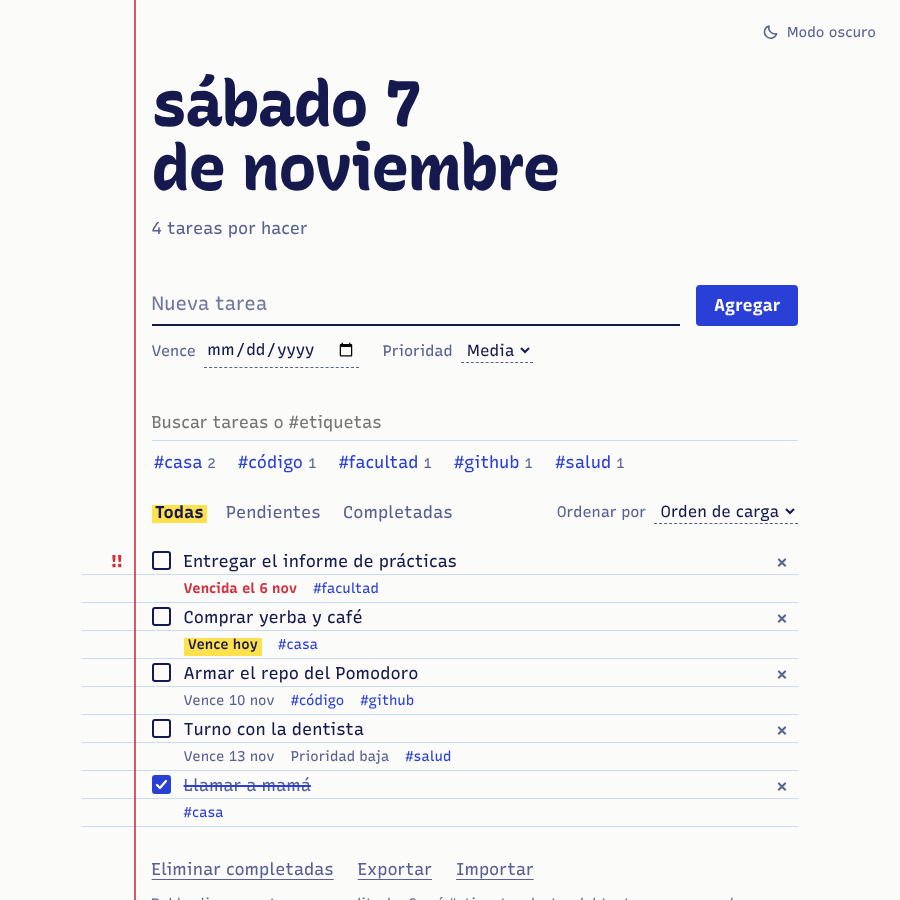
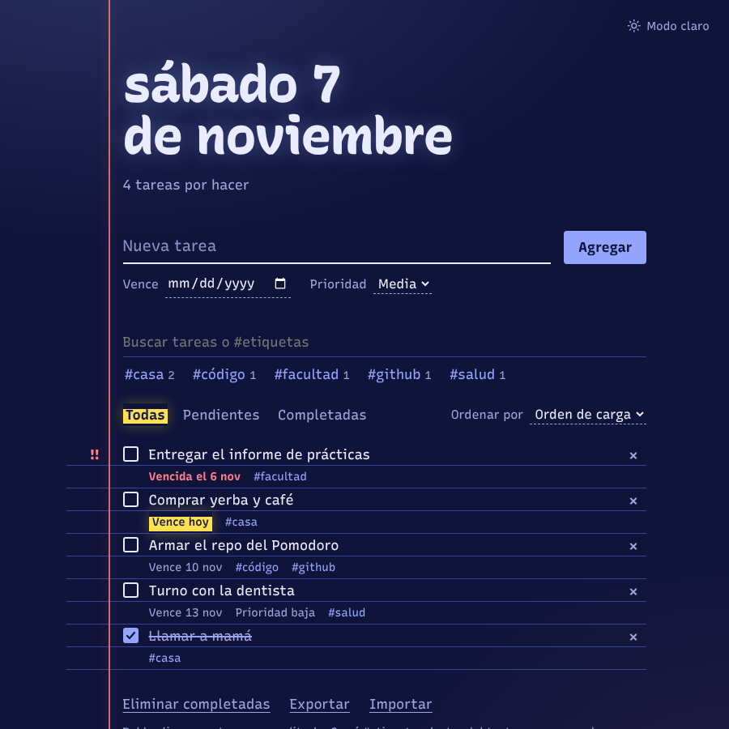
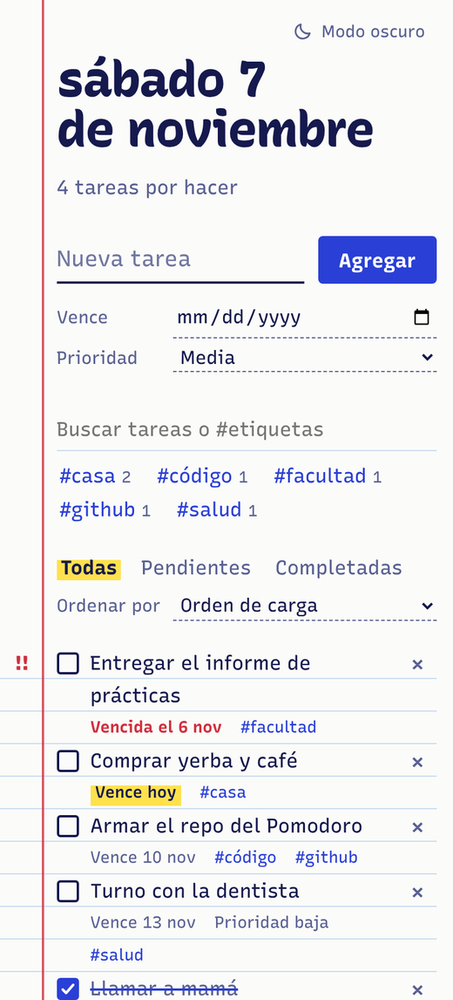

# Tareas

[](https://github.com/mmodugno/todo-app/actions/workflows/test.yml)

Lista de tareas con aspecto de hoja de cuaderno rayado, hecha con **HTML, CSS y JavaScript vanilla** (sin frameworks ni dependencias). Se guarda en el navegador, se instala como app y funciona sin conexión.

**Demo:** https://mmodugno.github.io/todo-app/

<p align="center">
  
  
</p>
<p align="center">
  
</p>

## Funcionalidades

**Tareas**
- Agregar, completar, editar y eliminar (doble clic para editar; Enter guarda y Escape cancela)
- **Fecha de vencimiento** con aviso de tareas vencidas y de las que vencen hoy
- **Prioridad** alta, media o baja (la alta se marca en el margen)
- **Etiquetas** escribiendo `#casa` dentro del texto, y filtro por etiqueta
- **Búsqueda** que ignora mayúsculas y acentos (`cafe` encuentra `Café`)
- Filtros por estado y orden por carga, prioridad, vencimiento o más nuevas
- **Deshacer** al eliminar una tarea o varias completadas

**Datos**
- Guardado automático en `localStorage`, tolerante a datos corruptos o storage no disponible
- **Exportar e importar** en JSON, sin duplicar las tareas que ya existen
- Migración automática de datos guardados por versiones anteriores

**Experiencia**
- **Modo claro y oscuro** con botón; si no elegís, sigue al sistema
- **PWA**: se instala en el celular o la compu y abre sin internet
- **Pensada para el celular**: formulario fijo abajo con atajos (Hoy, Mañana, +1 semana), filtros pegados arriba, hoja inferior para editar con un toque, menú ⋯ y gestos (deslizá a la derecha para completar, a la izquierda para eliminar)
- Diseño responsive, sin desbordes desde 320 px hasta pantallas grandes
- Accesible: etiquetas ARIA, foco visible, uso completo con teclado y respeto de `prefers-reduced-motion`

## Cómo correrla

Usa módulos ES, así que no se puede abrir con doble clic sobre `index.html`; hay que servirla con cualquier servidor estático:

```bash
npm start
# o, sin Node:
python -m http.server 8000
```

Después abrí http://localhost:3000 (o el puerto que indique la terminal).

## Tests

La lógica vive en `todos.js`, `theme.js` y `gestures.js` como funciones puras, así que se prueba sin navegador con el test runner integrado de Node (18 o superior):

```bash
npm test
```

Son 97 tests en 8 archivos. Además de la lógica, validan el manifest, los íconos y que el service worker guarde todos los archivos que usa la app. El CI de GitHub Actions los corre en Node 20 y 22 en cada push y pull request.

## Estructura

```
├── index.html               # Estructura de la página
├── styles.css               # Estilos: hoja rayada, claro/oscuro, responsive
├── app.js                   # Interfaz: DOM y eventos
├── todos.js                 # Lógica pura de tareas
├── theme.js                 # Lógica pura del tema
├── gestures.js              # Gestos de deslizar (decisión pura + eventos táctiles)
├── sw.js                    # Service worker (modo sin conexión)
├── manifest.webmanifest     # Datos para instalar la app
├── fonts/                   # Recursive (licencia OFL), incluida para funcionar offline
├── icons/                   # Íconos de la app
├── scripts/
│   └── generate-icons.py    # Genera los íconos con Pillow
├── docs/                    # Capturas del README
├── test/                    # Tests de la lógica y de la PWA
└── .github/workflows/       # CI
```

## Decisiones de diseño

- **Lógica separada de la interfaz:** `todos.js`, `theme.js` y `gestures.js` (la decisión de qué hace un gesto) no tocan el DOM, así que son fáciles de testear y reutilizar.
- **Inmutabilidad:** cada operación devuelve un array nuevo en lugar de modificar el anterior, lo que simplifica el deshacer.
- **Sin `innerHTML`:** todo el texto del usuario se inserta con `textContent`, lo que evita la inyección de HTML.
- **Datos viejos siempre válidos:** `normalizeTodo` completa o descarta los campos al cargar o importar, de modo que agregar funciones no rompe lo ya guardado.
- **Una identidad visual, no una plantilla:** renglones azules, margen rojo, tinta de birome y resaltador amarillo. Todo en la lista mide una unidad vertical (`--u`), igual a la separación entre renglones, y no hay tarjetas ni botones tipo píldora.
- **Service worker "primero la red":** con internet siempre se sirve la versión más nueva; sin internet, la guardada.

## Cómo se construyó

Cada funcionalidad se desarrolló en su propia rama (`feat/...`, `fix/...`, `ci/...`), con commits separados para la lógica, los tests y la interfaz, y se integró a `main` con un merge. El recorrido se puede ver con:

```bash
git log --graph --oneline
```

## Próximos pasos

- Reordenar tareas con arrastrar y soltar
- Subtareas y tareas repetidas
- Sincronizar entre dispositivos

## Licencia

[MIT](LICENSE). La tipografía [Recursive](https://github.com/arrowtype/recursive) se distribuye bajo la licencia SIL OFL (ver `fonts/OFL.txt`).
